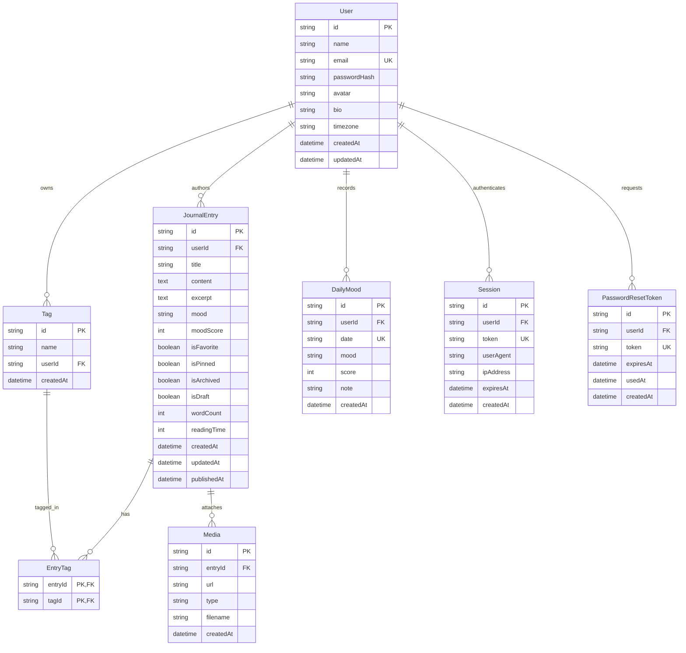

# LumaJournal — Database Documentation

## Overview

LumaJournal uses **PostgreSQL** as its primary relational database management system, managed via **Prisma ORM**. The schema is designed for security, strict referential integrity, and efficient querying across journal entries, tags, daily mood logs, and user sessions.

---

## Entity-Relationship Diagram (ERD)



---

## Tables & Columns Specification

### 1. `User`
Stores registered account credentials and profile settings.

| Column | Type | Modifiers | Description |
|---|---|---|---|
| `id` | `UUID / String` | `PRIMARY KEY` | Unique user identifier |
| `name` | `VARCHAR(255)` | `NOT NULL` | Display name |
| `email` | `VARCHAR(255)` | `NOT NULL, UNIQUE` | Unique login email address |
| `passwordHash` | `VARCHAR(255)` | `NOT NULL` | bcrypt hashed password |
| `avatar` | `TEXT` | `NULLABLE` | Avatar image URL or path |
| `bio` | `TEXT` | `NULLABLE` | Short biographical statement |
| `timezone` | `VARCHAR(64)` | `DEFAULT 'UTC'` | User preferred timezone |
| `createdAt` | `TIMESTAMP` | `DEFAULT now()` | Account creation timestamp |
| `updatedAt` | `TIMESTAMP` | `AUTO-UPDATE` | Last modification timestamp |

**Indexes:**
* `INDEX (email)` for fast credential lookups.

---

### 2. `JournalEntry`
Core entity storing users' reflections, drafts, and published thoughts.

| Column | Type | Modifiers | Description |
|---|---|---|---|
| `id` | `UUID / String` | `PRIMARY KEY` | Unique entry identifier |
| `userId` | `UUID / String` | `NOT NULL, FK -> User(id)` | Cascading delete foreign key |
| `title` | `VARCHAR(255)` | `NOT NULL` | Entry title |
| `content` | `TEXT` | `NOT NULL` | Full formatted HTML / Markdown content |
| `excerpt` | `TEXT` | `NOT NULL` | Plain text preview for list & cards |
| `mood` | `VARCHAR(32)` | `NULLABLE` | Associated mood key (e.g., `calm`, `good`) |
| `moodScore` | `INTEGER` | `NULLABLE` | Numerical mood score (1 to 5) |
| `isFavorite` | `BOOLEAN` | `DEFAULT false` | Starred / favorite flag |
| `isPinned` | `BOOLEAN` | `DEFAULT false` | Pinned to top of journal view |
| `isArchived` | `BOOLEAN` | `DEFAULT false` | Hidden from main view |
| `isDraft` | `BOOLEAN` | `DEFAULT false` | Autosave draft state |
| `wordCount` | `INTEGER` | `DEFAULT 0` | Computed word count |
| `readingTime` | `INTEGER` | `DEFAULT 1` | Estimated reading time (minutes) |
| `createdAt` | `TIMESTAMP` | `DEFAULT now()` | Timestamp of entry |
| `updatedAt` | `TIMESTAMP` | `AUTO-UPDATE` | Timestamp of last edit |
| `publishedAt` | `TIMESTAMP` | `NULLABLE` | Initial publish timestamp |

**Indexes:**
* `INDEX (userId)`: Essential for multi-tenant isolation.
* `INDEX (createdAt)`: Sorting entries chronologically.
* `INDEX (mood)`: Filtering by mood.
* `INDEX (isFavorite)`: Quick access to starred entries.
* `INDEX (isPinned)`: Sorting pinned entries to top.
* `INDEX (isArchived)`: Separating active from archived entries.
* `INDEX (isDraft)`: Identifying drafts vs published entries.

---

### 3. `Tag` and `EntryTag`
Many-to-many categorization for journal entries per user.

* `Tag`: Unique constraint on `[name, userId]` ensuring tags are private to each user without duplicates.
* `EntryTag`: Composite primary key `[entryId, tagId]` with cascading delete upon entry or tag removal.

---

### 4. `DailyMood`
Tracks high-level daily mood logs independent of entries for longitudinal emotional health insights.

* Unique constraint on `[userId, date]` ensuring one logged mood per calendar date (`YYYY-MM-DD`).

---

### 5. `Session` and `PasswordResetToken`
Manages authenticated active sessions and cryptographically random reset tokens with expiration timestamps.

---

## Migration & Seeding Instructions

1. Start PostgreSQL with Docker:
   ```bash
   docker compose up -d
   ```
2. Push or migrate schema:
   ```bash
   npx prisma migrate dev --name init
   # or for rapid schema sync:
   npx prisma db push
   ```
3. Seed sample data:
   ```bash
   npm run db:seed
   ```
